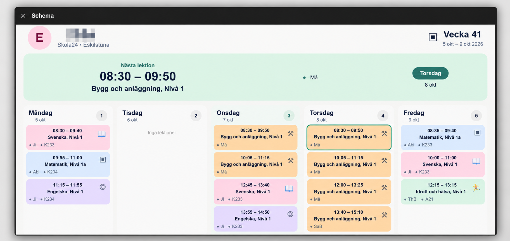

# Skola24 Schema – Home Assistant

A custom Home Assistant integration for retrieving personal schedules from Skola24.

## Features

- Select the Skola24 login domain during setup.
- Log in with a Skola24 username and password.
- Automatically discover students available under **Mina barn** when supported.
- Use a student's **SchemaID** as the stable identifier for the personal schedule.
- Regenerate the Skola24 signature from SchemaID when fetching a schedule, avoiding stale cached selections.
- Show the current and upcoming school weeks in Home Assistant.
- Cache previously fetched weeks to make week navigation significantly faster.
- Configure the weekday/time used for the automatic week change.
- Configure how many future weeks are retained.
- Configure the schedule update interval.
- Provide buttons for manual schedule refresh and week navigation.

## Installation

### HACS

1. Open HACS in Home Assistant.
2. Open the **Integrations** section.
3. Open the three-dot menu and choose **Custom repositories**.
4. Add `Kretiandpleti/skola-24-haos-integration`.
5. Select **Integration** and install **Skola24 Schema**.
6. Restart Home Assistant.

### Manual

Copy the `custom_components/skola24` directory into your Home Assistant `config/custom_components/` directory.

The resulting structure should be:

```text
config/
└── custom_components/
    └── skola24/
        ├── brand/
        │   └── icon.png
        ├── __init__.py
        ├── api.py
        ├── button.py
        ├── config_flow.py
        ├── const.py
        ├── coordinator.py
        ├── domains.py
        ├── en.json
        ├── manifest.json
        ├── sensor.py
        └── sv.json
```

Restart Home Assistant and add **Skola24 Schema** from **Settings → Devices & services → Add integration**.

## Configuration

During setup you select:

- Skola24 domain
- Student name
- Entity ID
- Username
- Password
- Optional SchemaID

The integration includes the available Skola24 domains from the supplied Skola24 login-domain list.

After login, the integration can discover students and their SchemaIDs. The SchemaID is then used to generate the signature required to retrieve the personal timetable.

### SchemaID

A SchemaID can be found in Skola24 under:

**Mina inställningar → Mina uppgifter → Mina barn**

If automatic discovery does not work, the SchemaID can be entered manually. If you only have one child and the integration discovers the student automatically, you may not need to enter the SchemaID manually.

## Options

The integration options allow you to configure:

- Skola24 domain
- Student
- Entity ID
- Day and time for automatic week changes
- Number of future weeks
- Update interval

Previously fetched weeks are cached in memory to speed up navigation. A Home Assistant restart clears this cache.

## Entity examples

A configured student may create entities such as:

```text
sensor.skola24_elev
button.skola24_elev_hamta_schema_nu
button.skola24_elev_forra_veckan
button.skola24_elev_nasta_veckan
```

The exact entity IDs depend on the Entity ID selected during configuration.

## Security

Credentials are stored in the Home Assistant config entry. Do not commit your Home Assistant configuration, credentials, or personal SchemaIDs to a public repository.

The integration itself does not contain user credentials or personal student SchemaIDs.

## Version history

### Version 0.6.9

- Added in-memory caching for previously fetched school weeks.
- Improved week navigation by fetching only the selected week when it is not cached.
- Preserved scheduled updates and existing sensor data.

### Version 0.6.8

- Improved schedule retrieval and handling of weeks without lessons, such as school holidays.
- Improved handling of invalid SchemaID errors.

### Version 0.6.4

- Prepared the integration for public repository use.
- Corrected the manifest version to `0.6.4`.
- Removed an unnecessary hardcoded Eskilstuna host constant.
- Removed the Eskilstuna-specific fallback used when generating the config-entry unique ID.
- Updated documentation from the development-oriented 0.6.x README to generic Skola24 documentation.

## Example

Example of how a Skola24 schedule can be displayed in Home Assistant:




## Lovelace-exempel

Nedan följer ett komplett exempel på ett Lovelace-kort som visar elevens schema, nästa lektion och knappar för att bläddra mellan veckor. Exemplet använder `custom:button-card` och `card_mod`, så dessa kort behöver vara installerade i Home Assistant.

**Viktigt:** Byt ut `ELEV` i koden mot den del av entitetens ID som gäller för din elev. Om sensorn till exempel heter `sensor.skola24_ebba`, ska `sensor.skola24_ELEV` ändras till `sensor.skola24_ebba`. Gör motsvarande ändring för knapparna för förra och nästa vecka. Ändra även texten `ELEV` som visas som elevens namn i kortets rubrik till det namn du vill visa.

Lägg till koden som ett manuellt Lovelace-kort:

```yaml
type: vertical-stack
cards:
  - type: horizontal-stack
    cards:
      - type: button
        entity: button.skola24_ELEV_forra_veckan
        name: Förra veckan
        icon: mdi:chevron-left
        show_state: false
        tap_action:
          action: call-service
          service: button.press
          target:
            entity_id: button.skola24_ELEV_forra_veckan
        hold_action:
          action: none
        card_mod:
          style: |
            ha-card {
              height: 52px !important;
              min-height: 52px !important;
              max-height: 52px !important;
              border-radius: 14px;
              background: #f7f7f5;
              box-shadow: 0 4px 14px rgba(0,0,0,0.06);
            }
            ha-icon {
              --mdc-icon-size: 22px;
            }
            .name, ha-icon {
              color: #14213d;
            }
      - type: button
        entity: button.skola24_ELEV_nasta_vecka
        name: Nästa vecka
        icon: mdi:chevron-right
        show_state: false
        tap_action:
          action: call-service
          service: button.press
          target:
            entity_id: button.skola24_ELEV_nasta_vecka
        hold_action:
          action: none
        card_mod:
          style: |
            ha-card {
              height: 52px !important;
              min-height: 52px !important;
              max-height: 52px !important;
              border-radius: 14px;
              background: #f7f7f5;
              box-shadow: 0 4px 14px rgba(0,0,0,0.06);
            }
            ha-icon {
              --mdc-icon-size: 22px;
            }
            .name, ha-icon {
              color: #14213d;
            }
  - type: custom:button-card
    update_timer: 1s
    entity: sensor.skola24_ELEV
    triggers_update:
      - sensor.skola24_ELEV
    show_name: false
    show_icon: false
    show_state: false
    styles:
      card:
        - padding: 0
        - margin: 0
        - border-radius: 28px
        - background: '#f7f7f5'
        - box-shadow: 0 8px 30px rgba(0,0,0,0.08)
        - overflow: hidden
      grid:
        - grid-template-areas: '"content"'
        - grid-template-columns: 1fr
        - grid-template-rows: auto
      custom_fields:
        content:
          - width: 100%
    custom_fields:
      content: |
        [[[
          const a = states['sensor.skola24_ELEV']?.attributes || {};
          const allLessons = a.lessons || [];
          const weeks = a.weeks || {};
          const now = new Date();

          // ISO-VECKA
          function getISOWeekInfo(date) {
            const d = new Date(date.getFullYear(), date.getMonth(), date.getDate());
            const day = d.getDay() || 7;
            d.setDate(d.getDate() + 4 - day);
            const year = d.getFullYear();
            const yearStart = new Date(year, 0, 1);
            const week = Math.ceil((((d - yearStart) / 86400000) + 1) / 7);
            return { year, week };
          }

          // DATUM FRÅN ISO-VECKA
          function getDateFromWeek(year, week, day) {
            const jan4 = new Date(year, 0, 4);
            const monday = new Date(jan4);
            monday.setDate(jan4.getDate() - (jan4.getDay() || 7) + 1 + ((week - 1) * 7));
            monday.setDate(monday.getDate() + day - 1);
            return monday;
          }

          // Skola24-integrationen bestämmer vilken vecka som visas.
          const iso = getISOWeekInfo(now);
          const year = Number(a.current_year) || iso.year;
          const week = Number(a.current_week) || iso.week;

          // VECKANS LEKTIONER
          const weekData = weeks[String(week)];
          const weekLoaded = Array.isArray(weekData);
          const weekLessons = weekLoaded
            ? weekData
            : (Number(a.current_week) === week ? allLessons : []);

          const months = ["jan", "feb", "mar", "apr", "maj", "jun", "jul", "aug", "sep", "okt", "nov", "dec"];
          const dayNames = ["Måndag", "Tisdag", "Onsdag", "Torsdag", "Fredag"];

          function timeText(time) {
            return time ? time.substring(0, 5) : "";
          }

          function dateText(date) {
            return `${date.getDate()} ${months[date.getMonth()]}`;
          }

          function subjectClass(subject) {
            const s = (subject || "").toLowerCase();
            if (s.includes("svenska")) return "svenska";
            if (s.includes("matematik")) return "matte";
            if (s.includes("engelska")) return "engelska";
            if (s.includes("bygg")) return "bygg";
            if (s.includes("idrott")) return "idrott";
            if (s.includes("mentor")) return "mentor";
            return "other";
          }

          function subjectIcon(subject) {
            const s = (subject || "").toLowerCase();
            if (s.includes("svenska")) return "📖";
            if (s.includes("matematik")) return "▣";
            if (s.includes("engelska")) return "◎";
            if (s.includes("bygg")) return "⚒";
            if (s.includes("idrott")) return "🏃";
            if (s.includes("mentor")) return "●●●";
            return "";
          }

          let today = now.getDay();
          if (today === 0) today = 7;

          // Använd integrationens nästa lektion om den finns.
          let next = a.next_lesson || null;
          if (!next && weekLessons.length) {
            next = [...weekLessons].sort((a, b) => {
              const dayA = Number(a.dayOfWeekNumber || a.day_of_week || 1);
              const dayB = Number(b.dayOfWeekNumber || b.day_of_week || 1);
              if (dayA !== dayB) return dayA - dayB;
              return (a.start || "").localeCompare(b.start || "");
            })[0] || null;
          }

          let nextHtml = "";
          if (next) {
            const nextDay = Number(next.dayOfWeekNumber || next.day_of_week || 1);
            const nextDate = getDateFromWeek(year, week, nextDay);
            const nextIsToday = nextDay === today &&
              now.getFullYear() === year &&
              now.getMonth() === nextDate.getMonth() &&
              now.getDate() === nextDate.getDate();

            nextHtml = `
              <div class="next-inner">
                <div class="next-main">
                  <div class="next-label">Nästa lektion</div>
                  <div class="next-time">${timeText(next.start)} – ${timeText(next.end)}</div>
                  <div class="next-subject">${next.subject || ""}</div>
                </div>
                <div class="next-details">
                  <div><span class="detail-icon">●</span>${next.teacher || "Lärare"}</div>
                  ${next.room ? `<div><span class="detail-icon">●</span>${next.room}</div>` : ""}
                </div>
                <div class="next-day">
                  <div class="today-pill">${nextIsToday ? "Idag" : (dayNames[nextDay - 1] || "")}</div>
                  <div class="next-date">${dateText(nextDate)}</div>
                </div>
              </div>`;
          } else {
            nextHtml = `
              <div class="next-empty">
                ${now.getDay() === 0 && !weekLoaded
                  ? `Vecka ${week} är inte laddad ännu`
                  : "Inga kommande lektioner"}
              </div>`;
          }

          // DAGSKOLUMNER
          let daysHtml = "";
          for (let d = 1; d <= 5; d++) {
            const date = getDateFromWeek(year, week, d);
            const dayLessons = weekLessons
              .filter(l => Number(l.dayOfWeekNumber || l.day_of_week) === d)
              .sort((a, b) => (a.start || "").localeCompare(b.start || ""));

            const isToday = d === today &&
              now.getFullYear() === year &&
              now.getMonth() === date.getMonth() &&
              now.getDate() === date.getDate();

            let lessonsHtml = "";
            dayLessons.forEach(l => {
              const isNext = next && l.guidId === next.guidId;
              lessonsHtml += `
                <div class="lesson ${subjectClass(l.subject)} ${isNext ? "next-highlight" : ""}">
                  <div class="lesson-time">${timeText(l.start)} – ${timeText(l.end)}</div>
                  <div class="lesson-subject">${l.subject || ""}</div>
                  <div class="lesson-info">
                    <span>● ${l.teacher || "Lärare"}</span>
                    ${l.room ? `<span>● ${l.room}</span>` : ""}
                  </div>
                  <div class="lesson-icon">${subjectIcon(l.subject)}</div>
                </div>`;
            });

            daysHtml += `
              <div class="day-column ${isToday ? "today-column" : ""}">
                <div class="day-header">
                  <div>
                    <div class="day-name">${dayNames[d - 1]}</div>
                    <div class="day-date">${dateText(date)}</div>
                  </div>
                  <div class="day-number">${d}</div>
                </div>
                <div class="lessons">
                  ${lessonsHtml || `<div class="no-lessons">Inga lektioner</div>`}
                </div>
              </div>`;
          }

          // UPPDATERINGSTID
          let updated = "";
          if (a.updated) {
            const dt = new Date(a.updated);
            updated = `${dt.getDate()} ${months[dt.getMonth()]} ${dt.getFullYear()} ${String(dt.getHours()).padStart(2, "0")}:${String(dt.getMinutes()).padStart(2, "0")}`;
          }

          const weekStart = getDateFromWeek(year, week, 1);
          const weekEnd = getDateFromWeek(year, week, 5);

          return `
            <div class="wrapper">
              <div class="header">
                <div class="profile">
                  <div class="avatar">A</div>
                  <div>
                    <div class="name">ELEV</div>
                    <div class="school">Skolschema</div>
                  </div>
                </div>
                <div class="week">
                  <div class="calendar">▣</div>
                  <div>
                    <div class="week-number">Vecka ${week}</div>
                    <div class="week-date">${dateText(weekStart)} – ${dateText(weekEnd)} ${year}</div>
                  </div>
                </div>
              </div>

              <div class="next-box">${nextHtml}</div>
              <div class="days">${daysHtml}</div>

              <div class="footer">
                <div>◆ ${weekLessons.length} lektioner denna vecka</div>
                <div>↻ Uppdaterad ${updated || "Okänd"}</div>
              </div>
            </div>`;
        ]]]
    extra_styles: |
      /* GRUND */
      .wrapper {
        width: 100%;
        box-sizing: border-box;
        padding: 26px;
        background: #f7f7f5;
        color: #14213d;
        font-family: Arial, Helvetica, sans-serif;
      }

      /* HEADER */
      .header {
        display: flex;
        justify-content: space-between;
        align-items: center;
        padding: 0 14px 22px 14px;
      }
      .profile {
        display: flex;
        align-items: center;
        gap: 20px;
      }
      .avatar {
        width: 82px;
        height: 82px;
        border-radius: 50%;
        background: #dcecff;
        display: flex;
        align-items: center;
        justify-content: center;
        font-size: 42px;
        font-weight: 700;
        color: #14213d;
      }
      .name {
        font-size: 40px;
        line-height: 1;
        font-weight: 700;
      }
      .school {
        margin-top: 7px;
        font-size: 20px;
        color: #53627e;
      }
      .week {
        display: flex;
        align-items: center;
        gap: 15px;
      }
      .calendar {
        font-size: 40px;
      }
      .week-number {
        font-size: 30px;
        font-weight: 700;
      }
      .week-date {
        margin-top: 4px;
        font-size: 17px;
        color: #53627e;
      }

      /* NÄSTA LEKTION */
      .next-box {
        margin-bottom: 20px;
        border-radius: 22px;
        overflow: hidden;
        background: linear-gradient(100deg, #e1f7e9, #d8f2e4);
      }
      .next-inner {
        min-height: 138px;
        display: grid;
        grid-template-columns: 1.5fr 1fr .7fr;
        align-items: center;
        padding: 24px 30px;
      }
      .next-main {
        min-width: 0;
      }
      .next-label {
        font-size: 19px;
        font-weight: 600;
        color: #27635f;
        margin-bottom: 6px;
      }
      .next-time {
        font-size: 43px;
        line-height: 1;
        font-weight: 700;
      }
      .next-subject {
        font-size: 24px;
        font-weight: 600;
        margin-top: 8px;
      }
      .next-details {
        font-size: 19px;
        line-height: 2;
      }
      .detail-icon {
        color: #286e69;
        margin-right: 8px;
      }
      .next-day {
        text-align: center;
      }
      .today-pill {
        display: inline-block;
        padding: 11px 27px;
        border-radius: 30px;
        background: #286e69;
        color: white;
        font-size: 19px;
        font-weight: 700;
      }
      .next-date {
        margin-top: 9px;
        font-size: 18px;
      }
      .next-empty {
        padding: 35px;
        font-size: 21px;
        color: #53627e;
      }

      /* DAGAR */
      .days {
        display: grid;
        grid-template-columns: repeat(5, minmax(0, 1fr));
        gap: 14px;
      }
      .day-column {
        min-width: 0;
        background: #fafafa;
        border-radius: 19px;
        padding: 12px;
      }
      .today-column {
        background: #f0f9f4;
      }
      .day-header {
        display: flex;
        justify-content: space-between;
        align-items: center;
        padding: 3px 8px 12px 8px;
      }
      .day-name {
        font-size: 22px;
        font-weight: 700;
      }
      .day-date {
        font-size: 16px;
        color: #53627e;
        margin-top: 3px;
      }
      .day-number {
        width: 40px;
        height: 40px;
        border-radius: 50%;
        background: #ededed;
        display: flex;
        justify-content: center;
        align-items: center;
        font-size: 17px;
        font-weight: 600;
      }
      .today-column .day-number {
        background: #dcefe6;
        color: #286e69;
      }

      /* LEKTIONER */
      .lessons {
        display: flex;
        flex-direction: column;
        gap: 10px;
      }
      .lesson {
        position: relative;
        border-radius: 13px;
        padding: 12px;
        min-height: 90px;
        box-sizing: border-box;
        overflow: hidden;
      }
      .lesson-time {
        font-size: 16px;
        font-weight: 700;
      }
      .lesson-subject {
        font-size: 16px;
        font-weight: 650;
        line-height: 1.16;
        margin-top: 5px;
        padding-right: 30px;
      }
      .lesson-info {
        display: flex;
        gap: 12px;
        flex-wrap: wrap;
        margin-top: 10px;
        font-size: 13px;
        color: #526079;
      }
      .lesson-icon {
        position: absolute;
        right: 12px;
        top: 12px;
        font-size: 25px;
        opacity: .7;
      }
      .no-lessons {
        padding: 15px 8px;
        color: #9a9a9a;
        font-size: 14px;
        text-align: center;
      }

      /* ÄMNESFÄRGER */
      .svenska { background: #ffd5e2; }
      .matte { background: #dcecff; }
      .engelska { background: #e5dcff; }
      .bygg { background: #ffd8a7; }
      .idrott { background: #d9f3e5; }
      .mentor { background: #ededed; }
      .other { background: #e7e7e7; }

      /* NÄSTA LEKTION - GRÖN RAM */
      .next-highlight {
        outline: 3px solid #15966d;
        outline-offset: -2px;
      }

      /* FOOTER */
      .footer {
        display: flex;
        justify-content: space-between;
        align-items: center;
        padding: 22px 14px 3px 14px;
        color: #46536a;
        font-size: 16px;
      }

      /* MOBIL */
      @media (max-width: 800px) {
        .header {
          flex-direction: column;
          align-items: flex-start;
          gap: 15px;
        }
        .next-inner {
          grid-template-columns: 1fr;
          gap: 12px;
        }
        .next-day {
          text-align: left;
        }
        .days {
          grid-template-columns: 1fr;
        }
        .footer {
          flex-direction: column;
          align-items: flex-start;
          gap: 8px;
        }
      }
```
